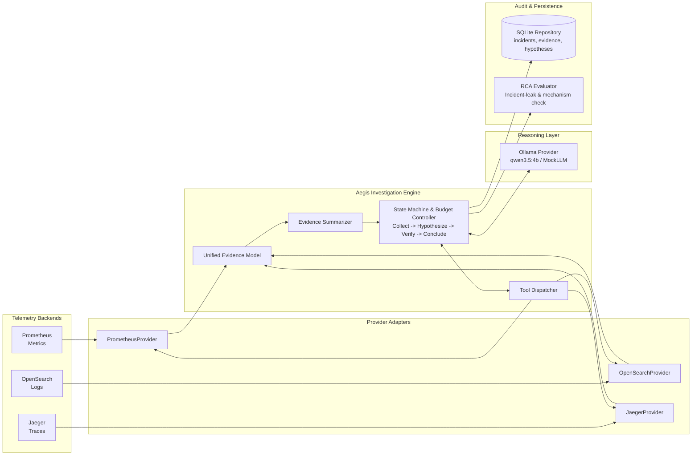

# Aegis — Evidence-Grounded Incident Investigation & Root Cause Analysis

[](#testing)
[](#testing)
[](#testing)
[](pyproject.toml)
[](LICENSE)

**Aegis** is an open-source, evidence-grounded incident investigation and root-cause analysis engine for microservices. It connects to live observability backends (**Prometheus**, **OpenSearch**, **Jaeger**), normalizes multi-modal telemetry into a unified `Evidence` model, and executes bounded diagnostic workflows using local small language models (e.g. `qwen3.5:4b`).

Unlike naive LLM wrappers that dump uncurated telemetry into prompts or restate incident symptoms, Aegis employs **error-focused telemetry filtering**, **pre-LLM structured summarization**, an **explicit finite state machine**, and an **evaluator with incident-leak detection** to deliver traceable, evidence-backed diagnostic hypotheses.

---

## Key Highlights

- **Provider-Agnostic Core**: Clean hexagonal architecture. The domain core (`src/domain/`) has zero dependencies on external telemetry or LLM libraries.
- **Multi-Modal Telemetry Normalization**: Automatically normalizes metrics (PromQL), logs (OpenSearch JSON DSL), and distributed traces (Jaeger span trees) into standardized `Evidence` objects with provenance tracking.
- **Pre-LLM Diagnostic Summarization**: Extracts latency percentiles (p50/p95/max), error counts, and service distributions before prompting, preventing catastrophic false negatives caused by naive token truncation.
- **Error-Focused Query Optimization**: Targeted error filtering reduces investigation duration by **2.3x** (137s vs 312s) and eliminates **59%** of evidence noise.
- **Leak-Aware RCA Evaluator**: Automated evaluation framework with incident-leak detection and causal language verification, validated against a 12-case benchmark with substantial single-human reference agreement ($\kappa = 0.778$).
- **Deterministic Offline Replay**: JSON snapshot export/import allows offline prompt engineering and benchmark evaluation without running live Docker clusters.
- **Strictly Typed & Audited**: 165 automated unit/integration tests (162 passed, 3 skipped for offline live-integration), strict `mypy` type checking (0 issues across 54 source files), and clean `ruff` linting.

---

## System Architecture



---

## Investigation State Machine

Aegis enforces a strict, auditable agent loop with configurable turn, tool call, and duration limits:

```
INCIDENT_CREATED 
      ↓
COLLECTING_EVIDENCE     → Dispatches metrics/logs/traces; summarizes diagnostic signals
      ↓
FORMING_HYPOTHESES      → Generates competing hypotheses; requests distinguishing verification tools
      ↓
VERIFYING_HYPOTHESES    → Executes targeted verification tool calls against telemetry backends
      ↓
CONCLUDING              → Derives diagnosis and classification (CONFIRMED / PLAUSIBLE / NO_ANOMALY / INSUFFICIENT)
      ↓
RECOMMENDATION          → Produces remediation action linked to specific evidence IDs
      ↓
RECORDED                → Persists full audit trail to SQLite
```

---

## Empirical Findings & Research Results

Aegis was evaluated on the [OpenTelemetry Astronomy Shop Demo](https://github.com/open-telemetry/opentelemetry-demo) under controlled fault injections (`productCatalogFailure`, `recommendationCacheFailure`, neutral descriptions, and healthy baselines):

| Research Dimension | Finding | Empirical Impact |
|:---|:---|:---|
| **Query Strategy (RQ2)** | Error-focused querying (`5xx` metrics, error logs, failed traces) | **2.3x faster** (137s vs 312s); **59% noise reduction** (66 vs 163 items) |
| **Context Summarization (RQ3)** | Pre-LLM structured statistical summary vs naive bounding | **Prevents False Negatives**; raw truncation caused model to miss active outages (`NO_ANOMALY`) |
| **Epistemic Uncertainty (RQ5)** | Neutral symptom-only descriptions ("Service Anomaly Detected") | Model honestly concludes **`INSUFFICIENT`** rather than hallucinating root causes (**0% prompt leak**) |
| **RCA Mechanism Limits** | 4B model causal inference capability | Reliably localizes **affected service** (`product-catalog`) and **symptoms**; cannot deduce underlying **feature flag mechanism** |
| **Evaluator Agreement** | Deterministic evaluator vs Single-Human reference benchmark | **83.3% observed agreement**, **Cohen's $\kappa = 0.778$** (substantial agreement) on 12 cases |

*Detailed tables and methodology are documented in [`docs/final-results.md`](docs/final-results.md).*

---

## Quickstart

### 1. Installation

```powershell
# Clone repository
git clone https://github.com/your-username/aegis.git
cd aegis

# Create and activate virtual environment
python -m venv .venv
.venv\Scripts\Activate.ps1   # On Linux/macOS: source .venv/bin/activate

# Install with development dependencies
pip install -e ".[dev]"
```

### 2. Run Mock Investigation (Zero External Dependencies)

```powershell
python -m src.investigation.demo --mock-llm
```

**Output snippet**:
```text
============================================================
Aegis Phase 2/3 - End-to-End Investigation
============================================================
[1] Initializing SQLite Repository...
[2] Registering Telemetry Providers... (MOCK)
[4] Generating Incident Scenario: scenario_payment_api_001
[7] Starting Investigation Engine (strategy: generic, summarizer: True)...

============================================================
Investigation Complete
============================================================
Incident ID      : inc_demo_1787588599
Final Status     : RECORDED
Duration         : 0:00:00.22s
Tool Calls       : 4 | LLM Turns: 2
Classification   : PLAUSIBLE
Diagnosis        : [PLAUSIBLE] High latency in downstream-db caused payment-api to fail.
Recommendation   : Scale up downstream-db replicas (Reason: High latency due to load)
============================================================
```

### 3. Run Live Investigation on OpenTelemetry Demo

1. **Start the OpenTelemetry Demo environment**:
   ```powershell
   .\scripts\start-otel-demo.ps1
   ```
2. **Start Ollama** with `qwen3.5:4b`:
   ```powershell
   ollama run qwen3.5:4b
   ```
3. **Run Aegis against live telemetry**:
   ```powershell
   python -m src.investigation.demo --live-telemetry
   ```
4. **Inject a controlled fault and investigate**:
   ```powershell
   # Inject product catalog failure
   python scripts/inject-fault.py --flag productCatalogFailure --value on

   # Run investigation with error-focused strategy
   python -m src.investigation.demo --live-telemetry --fault-scenario config/scenarios/product-catalog-failure.yaml --evidence-strategy error_focused

   # Recover healthy baseline
   python scripts/inject-fault.py --recover-all
   ```

---

## Testing & Quality Assurance

```powershell
# Run all 165 unit and integration tests
pytest tests/ -v

# Run human-annotation agreement validation test
pytest tests/test_human_annotation_validation.py -v -s

# Run strict type checking
mypy src/ tests/

# Run code linter
ruff check src/ tests/
```

---

## Project Structure

```text
aegis/
├── config/
│   ├── evaluator_human_annotations.json # 12-case human reference benchmark
│   ├── opentelemetry-demo.yaml          # Local telemetry endpoints config
│   └── scenarios/                       # Fault injection scenario definitions
├── docs/
│   ├── architecture.md                  # Mermaid diagrams & system architecture
│   ├── final-results.md                 # Consolidated research findings & empirical data
│   ├── human-annotation-guide.md        # Reference annotation rubric & guidelines
│   ├── reproducibility.md               # End-to-end reproduction guide
│   ├── portfolio-summary.md             # Executive portfolio summary
│   └── demo-script.md                   # 3-5 minute live demonstration script
├── scripts/
│   ├── inject-fault.py                  # Feature flag fault injection controller
│   ├── run-fault-investigation.py       # Automated batch experiment & RCA scoring harness
│   └── start-otel-demo.ps1              # Environment startup and verification scripts
├── src/
│   ├── adapters/                        # Prometheus, OpenSearch, Jaeger, Ollama adapters
│   ├── domain/                          # Pure domain models (Incident, Evidence, Hypothesis)
│   ├── evaluation/                      # Incident-leak aware RCA evaluator
│   ├── investigation/                   # InvestigationEngine, ToolDispatcher, Summarizer
│   └── persistence/                     # SQLite repository and deterministic replay engine
└── tests/                               # 122 unit, integration, and resilience tests
```

---

## Limitations

1. **Single-Human Reference Annotation**: The 12-case benchmark was annotated by a single human reference annotator, establishing substantial agreement ($\kappa = 0.778$) rather than multi-expert consensus.
2. **Model Scale Constraints**: Tested with `qwen3.5:4b` on CPU. Small open models localize failing components but cannot deduce deep configuration/flag mechanisms without explicit config telemetry.
3. **Single Microservice Benchmark**: Tested on the OpenTelemetry Astronomy Shop Demo (Docker Compose).
4. **Recommendation-Only Remediation**: Aegis produces remediation recommendations; automated execution is intentionally gated behind human approval.

---

## License

This project is licensed under the MIT License — see the [LICENSE](LICENSE) file for details.
