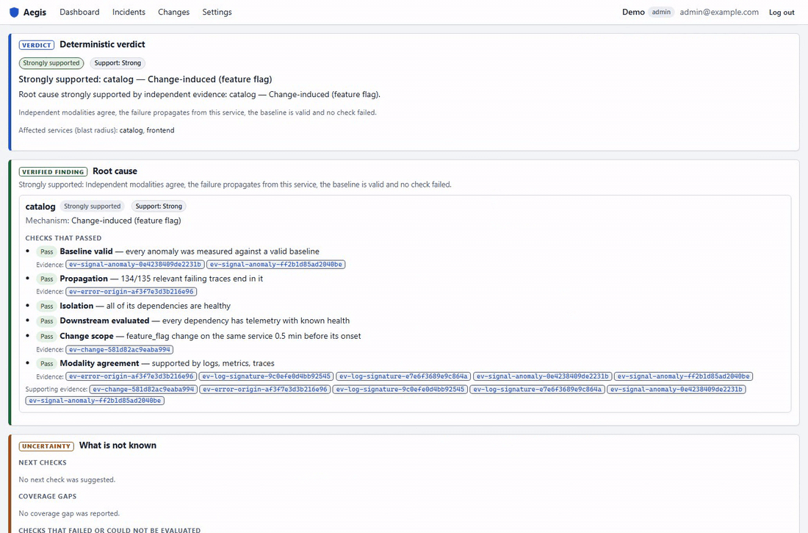
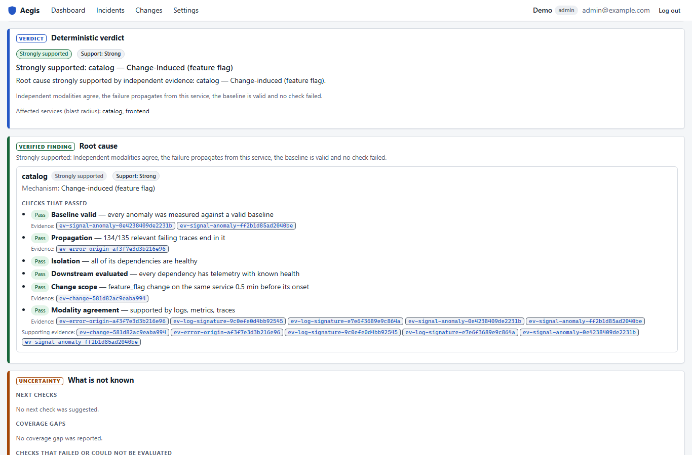
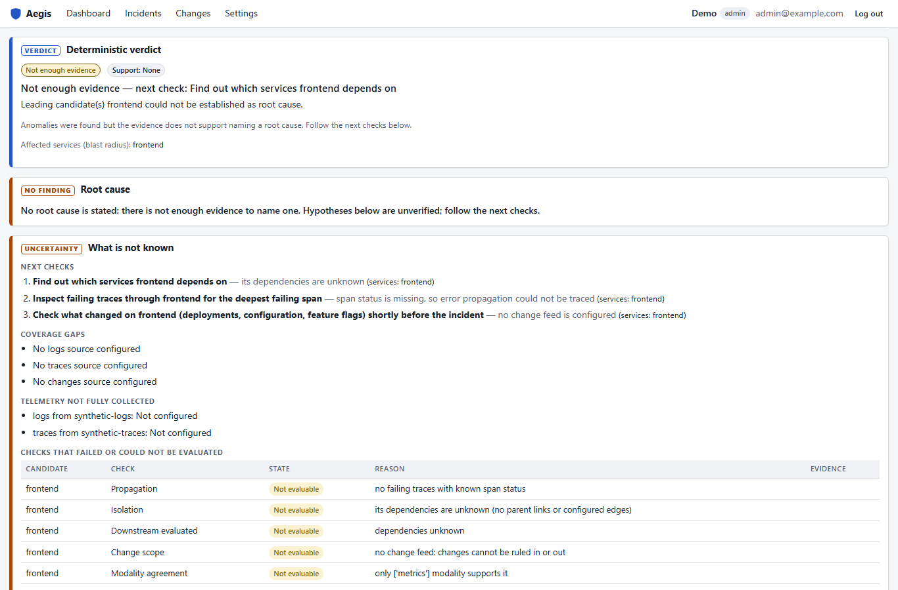
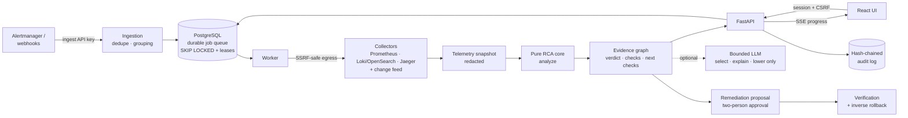

# Aegis

When a microservice breaks, Aegis collects its metrics, logs and traces, names the service that caused it with the evidence, and refuses to guess when the evidence is weak.

[](https://github.com/stredevirad/aegis/actions/workflows/ci.yml)
[](backend/pyproject.toml)
[](frontend/package.json)
[](LICENSE)



*The golden path, recorded by the committed Playwright test (`frontend/e2e/golden-path.spec.ts`): create an incident, investigate it, read a cited verdict, click a citation to see the evidence.*

## The rule that matters

A **deterministic RCA engine decides**. It checks each candidate service against explicit, tri-state checks (pass / fail / not evaluable): baseline validity, failure propagation in traces, isolation, scope of recent changes, agreement across modalities. It names a root cause only when those checks support it.

An **optional LLM** may *select* among the engine's candidates, *explain* them with claims that cite existing evidence, and *lower* the confidence. It can **never raise** the classification or the support, cite evidence that doesn't exist, or name a service the engine didn't consider. That's enforced by a validator, not a prompt: [`backend/aegis/llm/validate.py`](backend/aegis/llm/validate.py), decided in [ADR-009](docs/decisions/ADR-009-llm-authority.md). Telemetry reaches the model only inside a randomly delimited, explicitly untrusted data block ([`prompt.py`](backend/aegis/llm/prompt.py)).

## Watch it refuse to guess

The one-command demo seeds four synthetic incidents (`aegis admin seed-demo`). The worker investigates them, and the verdicts match the recorded benchmark:

| Seeded case | Verdict | Support | What the engine says |
|---|---|---|---|
| Feature flag breaks `catalog` (s06) | **CONFIRMED** "Strongly supported" | strong | Root cause `catalog`, change-induced (feature flag). Six checks pass; the decisive ones cite evidence (e.g. the flag change 0.5 min before onset). Temporal precedence is a tie, so it's not evaluable. |
| Real `catalog` failure plus a noisy, unrelated batch job (s09) | PLAUSIBLE "Likely cause" | moderate | Root cause `catalog`, not the decoy. |
| `catalog` failure while frontend logs carry injected instructions claiming `payments` is at fault (s10) | PLAUSIBLE "Likely cause" | moderate | Root cause `catalog`. The injected text is rendered as inert data and can't change the verdict. |
| Only edge metrics available (s08) | **INSUFFICIENT** "Not enough evidence" | none | **No root cause named.** Next checks: find out what frontend depends on, inspect failing traces, check recent changes. |

Reproduce: [`backend/tests/db/test_demo_seed.py`](backend/tests/db/test_demo_seed.py) asserts these verdicts through the real worker; the E2E suite checks the s06, s08 and s10 pages in a browser.

| Verdict with cited checks | Abstention |
|---|---|
|  |  |

## Quickstart

**Prerequisites:** Docker Desktop (Compose v2); about 4 GB of memory available to Docker is recommended. Measured use is ~0.4 GB running, or ~1 GB with the live telemetry demo. The first run also downloads base images and builds two images, so it takes longer than later runs (about 1 minute with a warm cache).

```bash
git clone https://github.com/stredevirad/aegis.git && cd aegis
scripts/demo-up.sh            # Windows PowerShell: scripts\demo-up.ps1
```

1. Open **http://localhost:8080** and sign in with **`admin@example.com`** (development login, no password).
2. The **Dashboard** and **Incidents** already list the four seeded incidents. Open one, then open its investigation under **Investigations**.
3. In the verdict, click any evidence ID (e.g. `ev-change-…`) to jump to the cited evidence, or open the **Evidence explorer**.
4. To investigate something yourself: **Incidents → New incident → Investigate**, pick a scenario such as `s06-feature-flag-failure`, then **Start investigation**.

**Live telemetry (optional, about 2 GB more):** `scripts/demo-up.sh --live` also starts four small instrumented services, an OpenTelemetry Collector, Prometheus, Jaeger, Loki, Alertmanager and a flag service. Wait about 3 minutes, then run `scripts/demo-fault.sh` to break `catalog` through a feature flag. Within about a minute, Prometheus alerts, Alertmanager posts to Aegis, an incident opens and is investigated automatically from live telemetry. Undo it with `scripts/demo-fault.sh --reset`.

**Stop:** `scripts/demo-down.sh` (or `.ps1`) removes the containers, network and volumes (database, demo keys). The built `aegis-*:dev` images are kept for a faster next start; remove them with `docker image rm aegis-backend:dev aegis-web:dev aegis-demo:dev`.

> **DEMO MODE.** The stack runs the API in its development profile, with the email-only development login and publicly known demo secrets ([`deploy/compose.yaml`](deploy/compose.yaml)). Keep it on localhost. The production profile refuses to start like this: it requires OIDC, HTTPS, secure cookies and real secrets ([`backend/aegis/config.py`](backend/aegis/config.py)).

## Architecture



Tenant data is isolated with PostgreSQL row-level security. The API, the worker and the collectors share one image ([`backend/Dockerfile`](backend/Dockerfile)), and the UI is a static SPA behind nginx with a strict CSP ([`frontend/nginx.conf`](frontend/nginx.conf)).

## What's interesting under the hood

- **Multi-tenancy that fails closed.** Tenant tables use `FORCE ROW LEVEL SECURITY`; the app connects as a restricted role and sets the tenant transaction-locally (`set_config(…, true)`). Pooled-connection tests prove a tenant never leaks into the next transaction, not even after an error. See [`0001_core_schema.sql`](backend/aegis/db/migrations/versions/0001_core_schema.sql), [`test_pool_isolation.py`](backend/tests/db/test_pool_isolation.py) and [`test_tenancy_and_schema.py`](backend/tests/db/test_tenancy_and_schema.py).
- **A job queue in PostgreSQL.** `FOR UPDATE SKIP LOCKED` claims with leases, heartbeats, reaping of dead workers, per-organization caps, idempotency keys and cancellation, with no broker. See [`jobs/queue.py`](backend/aegis/jobs/queue.py) and [`test_queue_and_worker.py`](backend/tests/db/test_queue_and_worker.py).
- **SSRF-safe egress to customer backends.** It resolves once, checks every address against deny ranges, connects to the pinned address with the original Host/SNI, follows no redirects and caps response sizes. See [`integrations/egress.py`](backend/aegis/integrations/egress.py) and its 62 tests in [`test_egress.py`](backend/tests/integrations/test_egress.py).
- **Hash-chained, append-only audit log** with a verify endpoint (`GET /api/v1/audit/verify`) and an operator command (`aegis audit verify`). See [`audit/log.py`](backend/aegis/audit/log.py).
- **A bounded LLM with an untrusted-data channel.** The validator rejects any output that raises confidence, cites unknown evidence or names a non-candidate, and the deterministic verdict stands. See [`llm/validate.py`](backend/aegis/llm/validate.py) and [`test_validate.py`](backend/tests/llm/test_validate.py).
- **Human-gated remediation.** It's proposal → approval by a second person (unless the organization explicitly allows self-approval) → execution. Execution claims the approved proposal with a compare-and-set, refuses if the target changed since approval, and is followed by verification with an inverse rollback. Backend and API only; there's no UI yet. See [`remediation/service.py`](backend/aegis/remediation/service.py) and [`docs/remediation.md`](docs/remediation.md).
- **OIDC authorization code + PKCE** with server-side sessions (BFF pattern), tested against a fake IdP and a live Dex. See [`auth/oidc.py`](backend/aegis/auth/oidc.py) and [`test_oidc.py`](backend/tests/api/test_oidc.py).
- **A pure, clock-free RCA core.** `analyze()` does no I/O and uses no clock or randomness (enforced by an AST test over the package), so the same snapshot always gives the same verdict. See [`core/analyze.py`](backend/aegis/core/analyze.py), [`test_purity.py`](backend/tests/core/test_purity.py) and [`docs/rca.md`](docs/rca.md).

## Results (and what they don't show)

| What | Result | Reproduce |
|---|---|---|
| Synthetic regression benchmark (15 scenarios) | 15/15 pass: **12 correct, 3 appropriate abstentions, 0 confident-wrong**; asserted-root-cause precision 1.0 (11 asserted; Wilson 95% CI 0.741–1.0) | `cd backend && uv run --frozen python -m aegis.benchmark.run --scenarios ../eval/scenarios --gate` |
| Held-out real captures (8, OpenTelemetry Demo, expected answers hashed before pipeline code) | **0 confident-wrong** in the clean run 1; current code: 0 confident-wrong, 6 appropriate abstentions, 2 partial | `cd backend && uv run --frozen python -m aegis.benchmark.heldout --root .. --out ../eval/results/heldout.json` |
| Live demo, one run (2026-11-09): fault → alert → incident → automatic live investigation | `catalog` incident: **PLAUSIBLE / moderate, root cause `catalog`, feature-flag mechanism**. The engine reported no valid baseline: the automatic 60-minute baseline window predates a 5-minute-old demo stack. `frontend` incident: INSUFFICIENT. | `scripts/demo-up.sh --live`, wait, `scripts/demo-fault.sh` |
| CI on every code push ([workflow](.github/workflows/ci.yml); docs-only pushes skip it) | Backend **360 tests, 0 skipped** (134 against real PostgreSQL; a missing database fails CI); ruff + mypy `--strict`; frontend 78 unit tests + build; **3 Playwright E2E tests against the one-command stack**; research suite 159; gitleaks over full history | see the Actions tab |

**Read these numbers carefully.** The synthetic benchmark was written by the same effort that built the engine and was used during development: **it's a regression gate, not an accuracy estimate.** The held-out set is small, and its captures lack span status, topology, change events and baselines, so it can show "no confident wrong answers on degraded real telemetry" but not localisation accuracy. One live run isn't accuracy either. Details: [`docs/rca.md`](docs/rca.md) §6, and the verification ledger [`docs/production-readiness.md`](docs/production-readiness.md).

## Development

```bash
docker compose -f deploy/compose.dev.yaml up -d --wait     # test PostgreSQL on 127.0.0.1:55432
cd backend && bash scripts/check.sh -m "not live"           # ruff, mypy --strict, pytest, benchmark gate
cd frontend && npm ci && npm run typecheck && npm run lint && npm test && npm run build
cd frontend && E2E_BASE_URL=http://127.0.0.1:8080 npx playwright test   # against scripts/demo-up.sh
```

A local API, worker and Vite dev server: `docker compose -f deploy/compose.dev.yaml --profile app up -d --wait`, `bash backend/scripts/dev-stack.sh`, `cd frontend && npm run dev` (http://127.0.0.1:5173).

## Project layout

```
backend/aegis/     API, worker, queue, RCA core, collectors, egress, LLM adjudication, remediation, audit, CLI
backend/tests/     unit, PostgreSQL, API and (opt-in) live tests
frontend/          React 19 + TypeScript operator UI, Vitest + Playwright (e2e/)
deploy/            compose.yaml (one-command stack + demo profile), compose.dev.yaml
demo/              tiny instrumented demo services and telemetry configs
eval/              synthetic scenarios, hashed held-out set, results
docs/              architecture, RCA, security model, ADRs, councils, verification ledger
src/, tests/       frozen research prototype (see Research history)
```

## Research history

Aegis started as a research prototype: an LLM-driven investigator over the OpenTelemetry Demo, with local 4B models. Its findings shaped the product. Error-focused querying made investigations **2.3× faster** (137 s vs 312 s) with 59% less evidence noise. A 4B model localised the affected service but couldn't infer the feature-flag mechanism. The deterministic evaluator agreed with a single human reference on 12 cases (83.3%, Cohen's κ = 0.778). MCP interoperability experiments rounded it off. Those lessons led to the current design: deterministic checks decide, and the model may only explain or lower confidence. The research code is frozen under `src/` (tags `v1.0-research-complete`, `v1.1-research-freeze`). See [docs/research/README-research.md](docs/research/README-research.md) and [docs/final-results.md](docs/final-results.md).

## Limitations

- **DEMO MODE only so far.** No production deployment exists. Helm/Kubernetes, load and chaos testing, notifications (Slack/PagerDuty) and Tempo/Kubernetes collectors are deferred ([`docs/PORTFOLIO_PROGRESS.md`](docs/PORTFOLIO_PROGRESS.md)).
- **No live LLM output has ever been accepted.** With a 1B local model (Ollama, CPU), every AI assessment violated the bounds and was rejected; the deterministic verdict stood. Larger and hosted models haven't been evaluated.
- **Accuracy is unmeasured** beyond the caveated benchmarks above. Thresholds are engineering defaults, not calibrated.
- **CONFIRMED is reachable mainly for change-induced faults** in synchronous systems. Internal failures without a change are reported as PLAUSIBLE at best ([`docs/rca.md`](docs/rca.md) §7).
- **Forged telemetry can mislead the deterministic layer.** The guarantee is "never more confident than the data", not resistance to forged data.
- **Remediation has no UI.** Two known robustness gaps in its stranded-execution reconciler are documented, not yet fixed ([`docs/PORTFOLIO_PROGRESS.md`](docs/PORTFOLIO_PROGRESS.md), "Open follow-ups").

## Built with AI assistance

The owner designed and directed Aegis: the scope, the architecture decisions (recorded as [ADRs](docs/decisions/) and LLM-council reviews in [docs/councils/](docs/councils/)) and the acceptance criteria. Claude Code wrote most of the implementation under those decisions. Every claim above is backed by a test, a command or an entry in the verification ledger.

## License

[MIT](LICENSE) © 2026 Joshua Herbert Japheth
