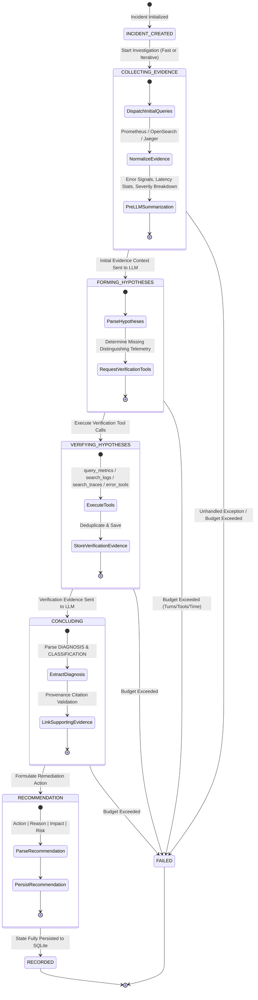
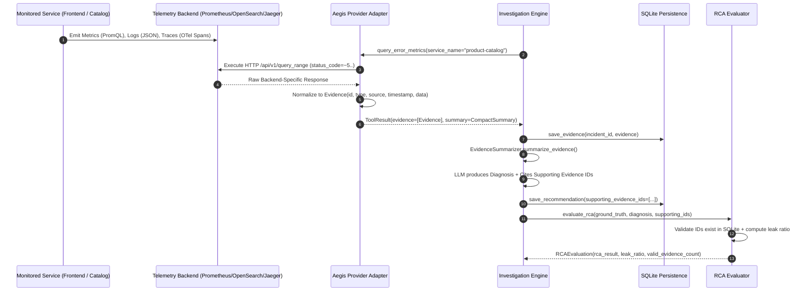
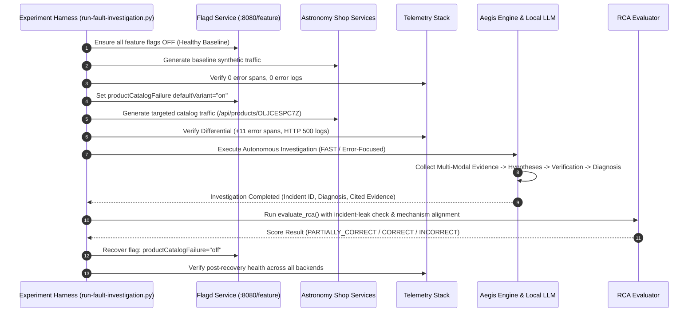

# Aegis Architecture & Lifecycle Reference

This document details the architectural layers, data flows, state machine lifecycle, evidence provenance, and experimental workflows of Aegis.

---

## 1. System Architecture Diagram

```mermaid
flowchart TD
    subgraph Presentation_Layer [Presentation & CLI]
        DemoCLI[src.investigation.demo<br/>CLI & Experiment Harness]
        BatchRunner[scripts/run-fault-investigation.py<br/>Automated Evaluation Harness]
    end

    subgraph Investigation_Layer [Investigation & Orchestration Layer]
        Engine[InvestigationEngine<br/>Finite State Machine & Budget Controller]
        Dispatcher[ToolDispatcher<br/>Pydantic Schema Validation & Tool Registry]
        Summarizer[EvidenceSummarizer<br/>Pre-LLM Diagnostic Feature Extraction]
    end

    subgraph Domain_Layer [Domain Core (Strictly Isolated)]
        Models[Domain Models<br/>Incident, Hypothesis, Evidence, ServiceHealth]
        Interfaces[Provider Interfaces<br/>MetricsProvider, LogsProvider, TracesProvider, LLMProvider]
        Enums[Domain Enums<br/>InvestigationStatus, EvidenceType, DiagnosisClassification]
    end

    subgraph Adapter_Layer [Adapter & Integration Layer]
        PromAdapter[PrometheusProvider<br/>PromQL Range Query Translation]
        OSAdapter[OpenSearchProvider<br/>Elastic/OpenSearch DSL Query Translation]
        JaegerAdapter[JaegerProvider<br/>Trace Tree & Span Structural Normalization]
        OllamaAdapter[OllamaProvider<br/>Multi-Turn Tool Calling & Thinking Tag Parser]
        ReplayAdapter[ReplayProvider<br/>Deterministic Snapshot Replay Provider]
        MockAdapters[MockProviders<br/>In-Memory Synthetic Test Providers]
    end

    subgraph Persistence_Layer [Persistence & Audit Layer]
        SQLiteRepo[SQLiteRepository<br/>Idempotent Migration & Relation Persistence]
        SQLiteDB[(aegis.db / aegis_demo.db<br/>Incidents, Evidence, Hypotheses, Events, Recommendations)]
        ReplaySnap[EvidenceSnapshot<br/>JSON Serialization & Replay Engine]
    end

    subgraph Evaluation_Layer [Evaluation & Validation Layer]
        RCAEval[RCAEvaluator<br/>Incident-Leak Detection & Causal Term Extraction]
        HumanBench[Human Benchmark Dataset<br/>12-Case Single-Human Reference Annotation]
    end

    DemoCLI --> Engine
    BatchRunner --> Engine
    Engine --> Dispatcher
    Engine --> Summarizer
    Engine --> SQLiteRepo
    Engine --> RCAEval

    Dispatcher --> Interfaces
    Interfaces <|.. PromAdapter
    Interfaces <|.. OSAdapter
    Interfaces <|.. JaegerAdapter
    Interfaces <|.. OllamaAdapter
    Interfaces <|.. ReplayAdapter
    Interfaces <|.. MockAdapters

    SQLiteRepo --> SQLiteDB
    ReplaySnap --> ReplayAdapter
    RCAEval --> HumanBench
```

---

## 2. Investigation Lifecycle State Machine

Aegis implements an auditable, finite state machine with strict turn, tool call, and duration budget enforcement:



---

## 3. Evidence Normalization & Provenance Flow



---

## 4. Controlled Fault-Injection Experiment Workflow



---

## 5. Architectural Invariants

1. **No External Framework Dependencies**: The core agent loop does not depend on LangChain, CrewAI, AutoGen, or similar orchestration frameworks. This ensures complete transparency, strict budget limits, and straightforward debugging.
2. **Deterministic Fallbacks**: Every LLM extraction step features robust regex fallbacks with structured error handling so malformed LLM responses never crash the investigation.
3. **Immutability of Evidence**: Evidence objects once collected and saved cannot be modified. They are linked via immutable foreign keys in SQLite.
4. **Timezone Awareness**: All datetime objects throughout domain models, persistence layers, and adapter interfaces strictly enforce UTC ISO-8601 timestamps.
