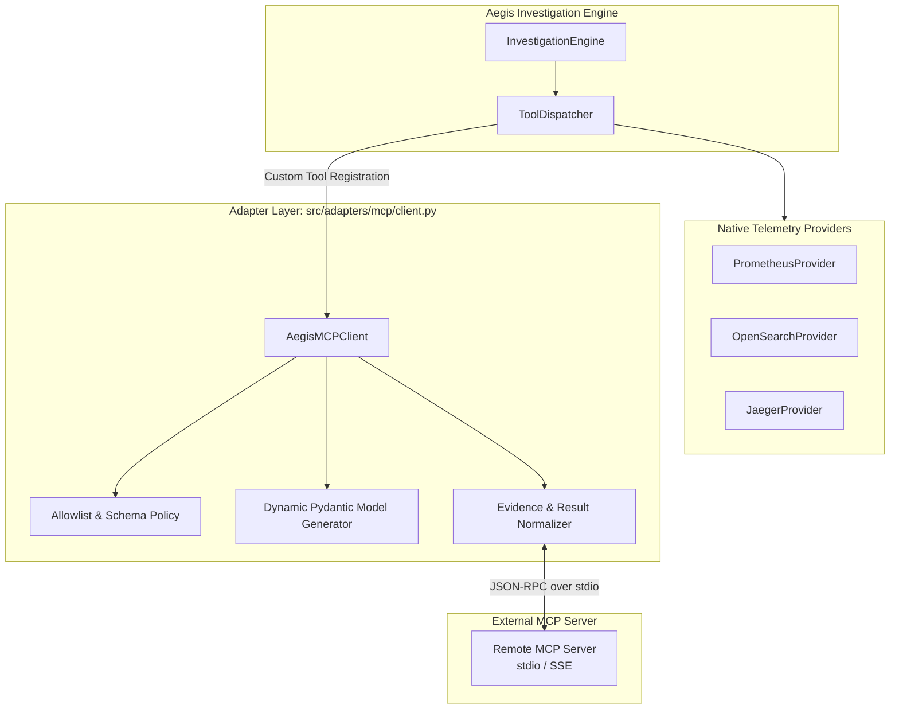

# Phase 4B — Aegis MCP Client Adapter

**Component**: Aegis MCP Client Adapter  
**Package**: `src/adapters/mcp/client.py`  
**Protocol / SDK Version**: Model Context Protocol Python SDK `mcp==2.0.0`  
**Status**: COMPLETE (Phase 4B)  

---

## 1. Purpose & Architecture

The Aegis MCP Client allows Aegis to consume external operational and context tools exposed by external Model Context Protocol (MCP) servers (such as OpenTelemetry Demo MCP services, infrastructure catalogs, or service registries) while strictly preserving Aegis's internal domain isolation, Evidence provenance, and security boundaries.



---

## 2. Mapping & Domain Independence

`src/domain/` remains completely unaware of MCP SDK types. The mapping between MCP structures and internal domain models occurs strictly within `AegisMCPClient`:

| Remote MCP Concept | Aegis Domain Model | Mapping Details |
|---|---|---|
| Remote `Tool` definition | `ToolDefinition` | Mapped to `name`, `description`, `parameters`, and `required` fields. |
| Remote input schema | Dynamic `BaseModel` | Built via `create_pydantic_args_model()` for argument type checking during dispatch. |
| `ToolCall` invocation | Remote `session.call_tool()` | JSON-RPC invocation over stdio or SSE transport. |
| Remote `CallToolResult` | `ToolResult` | Structured response containing normalized summary and reconstructed `Evidence` items. |
| Remote Evidence provenance | `Evidence` domain entity | Preserves `id`, `type`, `source_provider` (`mcp:<server_name>`), `service_resource`, and ISO timestamps. |

---

## 3. Security, Bounds & Allowlist Policy

External MCP servers are treated as untrusted boundaries. The client enforces:
1. **Explicit Tool Allowlist**: Only tool names explicitly listed in `allowed_tools` are discovered or permitted for execution. Any invocation of unapproved tools is immediately blocked.
2. **Payload Size Limits**: Outgoing tool arguments exceeding 10KB are rejected to prevent memory exhaustion or oversized JSON-RPC frames.
3. **Execution Timeouts**: All remote requests are bounded by a configurable timeout (default 15.0s), returning structured error results on timeout rather than hanging.
4. **Error Isolation**: Remote transport crashes, unhandled server exceptions, or malformed JSON responses are captured and translated into clean `ToolResult(summary={"status": "error", "error": ...})`.

---

## 4. Verification & Testing

The Phase 4B test suite (`tests/test_mcp_client.py`) validates:
- Tool discovery and allowlist filtering (approved vs unapproved tools).
- Invocation with full Evidence reconstruction and provenance preservation.
- Rejection of unapproved tools and oversized argument payloads.
- Dynamic Pydantic argument model generation across data types (`string`, `integer`, `boolean`, `number`).
- Integration and dispatch through `ToolDispatcher.register_custom_tool()`.
- Client timeout enforcement and error isolation.

```powershell
# Run MCP client tests
pytest tests/test_mcp_client.py -v
# ================= 9 passed in 37.05s =================
```
