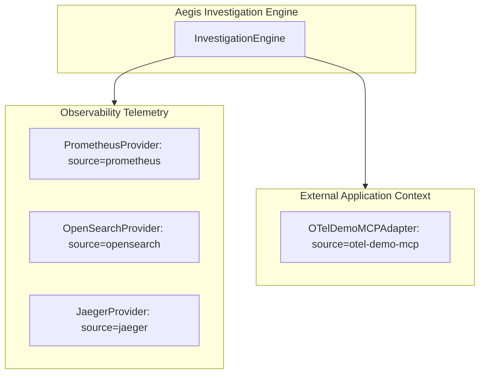

# Phase 4C — OpenTelemetry Demo MCP Integration

**Component**: OTel Demo MCP Service Adapter  
**Package**: `src/adapters/mcp/otel_demo.py`  
**Target Service**: `AstronomyShopMcp` (`astronomy-shop-mcp`)  
**Transport / Port**: Streamable FastMCP HTTP on `http://localhost:8011/mcp`  
**Status**: COMPLETE (Phase 4C)  

---

## 1. External Fixture Audit

Inspection of `external/opentelemetry-demo/` confirmed the exact MCP implementation in the demo:
- **Location**: `external/opentelemetry-demo/src/mcp/src/mcp_server/astronomy_shop_mcp_server.py`
- **Compose Layer**: `external/opentelemetry-demo/compose.agent.yaml` (service: `mcp`)
- **Server Implementation**: `FastMCP("astronomy-shop-mcp")` running over HTTP stream transport on port `8011`.

---

## 2. Tool Classification & Policy Boundary

Aegis classifies external tools strictly into **Read-Only Context Tools** vs **Mutating Actions**:

| Tool Name | Type | Policy | Usage in Aegis |
|---|---|---|---|
| `list_products` | Query / Catalog | **ALLOWED** | Provides microservice catalog context |
| `get_product` | Query / Product Detail | **ALLOWED** | Details on specific catalog items |
| `get_recommendations` | Query / Context | **ALLOWED** | Recommendation graph context |
| `get_supported_currencies`| Query / Metadata | **ALLOWED** | Currency configuration lookup |
| `get_shipping_quote` | Query / Cost Context | **ALLOWED** | Shipping rate calculation context |
| `get_ads` | Query / Context | **ALLOWED** | Ad placement context |
| `add_to_cart` | Mutation | **BLOCKED** | Rejected by read-only policy |
| `checkout` | Mutation | **BLOCKED** | Rejected by read-only policy |
| `empty_cart` | Mutation | **BLOCKED** | Rejected by read-only policy |

---

## 3. Observability vs Application Context Provenance

To preserve research integrity and prevent telemetry corruption:
1. **Telemetry Provenance**: Telemetry data (latency, error rates, spans, logs) originates *only* from `prometheus`, `opensearch`, and `jaeger`.
2. **MCP Application Context**: Any `Evidence` or context records originating from the OTel Demo MCP server are tagged with `source_provider="otel-demo-mcp"`.
3. **No Cross-Contamination**: MCP-derived context is never misattributed as metric or trace telemetry.



---

## 4. Verification & Testing

- **Unit Tests**: `tests/test_otel_mcp_integration.py` verifies allowlist enforcement, mutation blocking, and provenance labeling.
- **Graceful Live Skipping**: Live HTTP integration tests dynamically check `http://localhost:8011/mcp` and skip cleanly when the optional `compose.agent.yaml` container overlay is not started.

```powershell
# Run OTel Demo MCP integration suite
pytest tests/test_otel_mcp_integration.py -v
# ================= 3 passed, 1 skipped in 6.86s =================
```
