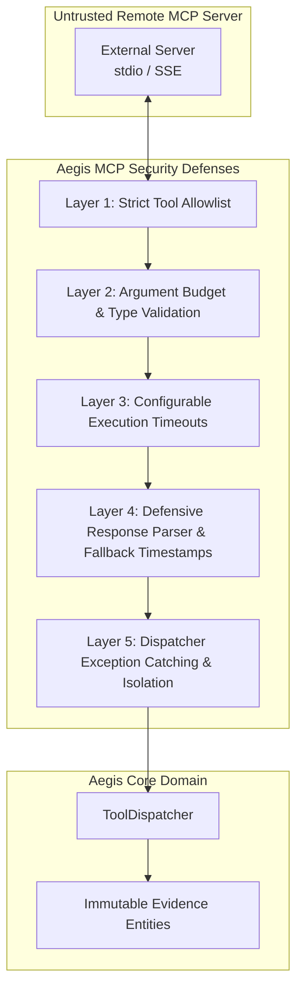

# Phase 4D — MCP Boundary Hardening & Adversarial Protection

**Component**: MCP Security & Boundary Hardening  
**Package**: `src/adapters/mcp/` & `src/investigation/tools.py`  
**Status**: COMPLETE (Phase 4D)  

---

## 1. Threat Model & Security Philosophy

External Model Context Protocol (MCP) servers and clients are treated as **untrusted external boundaries**. While MCP standardizes the communication format, external tools may crash, hang, return malformed schemas, return raw HTML error pages, or attempt to send oversized payloads.

Aegis enforces multi-layered defense-in-depth across the protocol adapter layer without letting protocol complexity leak into the domain core.



---

## 2. Hardened Boundary Defenses

### 2.1 Strict Tool Allowlisting
- The client maintains an explicit `allowed_tools` set.
- Unapproved tools are filtered out during discovery and rejected immediately at invocation time with a `ToolResult(summary={"status": "blocked", ...})`.

### 2.2 Argument Validation & Payload Limits
- Non-dictionary arguments (e.g. lists, primitive strings, null values) are rejected immediately.
- Outgoing JSON payloads are capped at 10KB to prevent memory bloat and transmission of unintended large blobs.
- Query strings and identifiers are sanitized and checked against length bounds.

### 2.3 Bounded Execution Timeouts
- Subprocess communication and remote tool invocations are wrapped in `asyncio.wait_for(...)` with strict timeout bounds (default 15.0s).
- If a remote server hangs or deadlocks, the client terminates the wait and returns a clean timeout error `ToolResult` rather than locking the engine loop.

### 2.4 Defensive Response Parsing
- **HTML / Plain-Text Payloads**: If a server returns an HTML error page (e.g., `502 Bad Gateway`), the parser treats it as plain text rather than raising a JSON decoding exception.
- **Empty Content Lists**: Returns a clean empty result rather than an index error.
- **Non-Text Content**: Safely records non-text blocks (such as images or audio) by summarizing their content type.
- **Fallback Timestamps**: If a remote Evidence payload lacks `observed_at` or `collected_at`, UTC timestamps with explicit timezone awareness are synthesized to prevent downstream temporal errors.

### 2.5 Dispatcher Boundary Isolation
- `ToolDispatcher.dispatch()` wraps custom tool invocations in defensive `try/except Exception` blocks, returning formatted error strings if a bridge handler throws an unhandled exception.
- Dynamic Pydantic argument models ensure that arguments dispatched to external tools are validated against declared schemas before execution.

---

## 3. Verification & Testing

The dedicated hardening test suite (`tests/test_mcp_hardening.py`) validates:
1. Rejection of non-dictionary arguments (`list`, `string`, `int`).
2. Rejection of oversized payloads (> 10KB).
3. Resilience against unicode, emoji, and JSON escape sequences.
4. Parsing of HTML error pages (`502 Bad Gateway`).
5. Handling of empty content lists and non-text content types (`ImageContent`).
6. Fallback UTC timestamps for untrusted evidence payloads.
7. Dispatcher exception catching and argument validation.

```powershell
# Run MCP hardening test suite
pytest tests/test_mcp_hardening.py -v
# ================= 9 passed in 12.37s =================
```
